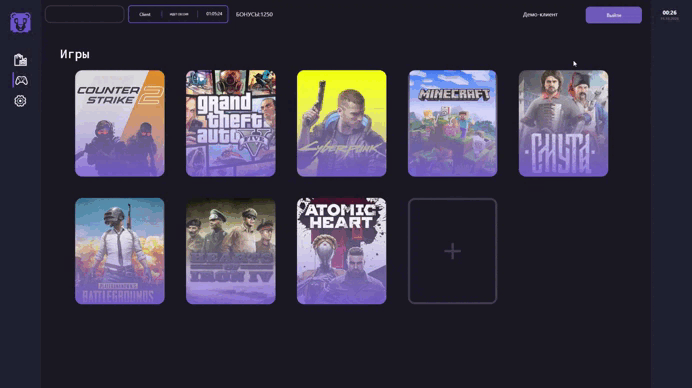

 
<p align="center">
   Дата создания: 15 декабря 2024 года. Учебный проект

</p>
<p align="center">
  WPF-приложение для компьютерного клуба: каталог игр, клиентский интерфейс и инструменты администратора.

</p>

<p align="center">
  <strong>.NET 8 · WPF · C# · Entity Framework Core · MySQL</strong>
</p>

## Демонстрация

### Главный экран и вход

<p align="center">
  
</p>

### Интерфейс клиента

<p align="center">
  
</p>

## Возможности

- Авторизация клиентов и сотрудников.
- Каталог игр с карточками и изображениями.
- Управление клиентами и пакетами игрового времени.
- Архив услуг и просмотр истории оказанных услуг.
- Оплата пакетов картой или бонусами, начисление бонусов.
- Статистика по оказанным услугам.

## Демо без базы данных

На главном экране нажмите «Войти», затем выберите «Демо: администратор» или «Демо: клиент». Демо открывает разделы с примерами данных и позволяет проверить переходы между экранами. Изменение записей и оплата в этом режиме отключены.

## Запуск

Нужны Windows 10 или новее, .NET 8 SDK и MySQL 8.

Откройте designclub.sln в Visual Studio 2022 или выполните из корня репозитория:

```powershell
dotnet restore
dotnet run --project designclub/designclub.csproj
```

Чтобы использовать функции, связанные с базой, задайте строку подключения в COMPUTERCLUB_DB. Пример для PowerShell:

```powershell
$env:COMPUTERCLUB_DB = "Server=localhost;User=root;Password=ваш-пароль;Database=ComputerClub"
```

База ComputerClub должна содержать таблицы, описанные в модели проекта. Дамп базы данных в репозитории не включён. Демо-режим запускается без MySQL.

## Публикация

Соберите Release-версию командой:

```powershell
dotnet publish designclub/designclub.csproj -c Release
```

Результат появится в designclub/bin/Release/net8.0-windows/publish. Для запуска на другом компьютере установите .NET 8 Desktop Runtime и настройте COMPUTERCLUB_DB.

## Структура проекта

```text
.
├── designclub/
│   ├── Assets/       медиа и изображения
│   ├── Data/         конфигурация базы данных
│   ├── Models/       модели и контекст Entity Framework
│   └── Views/        окна и интерфейс WPF
├── docs/demo/        GIF-демонстрации
├── designclub.sln
└── README.md
```


